# `tantra-agent` — DDD Architecture & AI Agent Bounded Context

## 1. Bounded Context & Safety Guardrails

`tantra-agent` (Tier 3A, evolved from `honba-nou`) is the **AI Reasoning & Autonomous Research Bounded Context**. Per the NoFX Untrusted AI Principle:

* LLMs are treated strictly as untrusted signal/decision proposers.
* Every LLM completion on the trading decision surface is parsed into `tantra_core::Decision` (`#[serde(deny_unknown_fields)]`), grounded against real-time `PriceBand`s, and clamped by `tantra_risk::RiskEngine`.
* The conversational surface is strictly **advisory**: no `ChatTool` produces a `Decision` or reaches `tantra-exec`.
* Every prompt, seed, temperature, and completion is SHA-256 hashed (`tantra-agent-replay`) for deterministic backtest replay.
* Zero floating-point math on the financial surface: all prices/quantities/money use `rust_decimal::Decimal` (`tantra_core::Price`/`Quantity`/`Money`). Internal return/statistics kernels in `tantra-agent-analytics`, `-forecast`, and `-panel` compute in `f64` without crossing the crate boundary (documented per-crate).

## 2. Architectural Dependency Rules (R1–R5)

Per Design Doc 0001, `tantra-agent` strictly enforces inverted dependencies. Rules are regression-tested via `crates/tantra-agent-chat/tests/dependency_rules.rs` inspecting `cargo metadata`:

* **R1**: No `tantra-agent-*` crate may depend on `tantra-runtime-*`. Runtime depends on agent or implements agent ports.
* **R2**: No `tantra-agent-*` crate may depend on `tantra-exec-*`. Execution is mediated by runtime and risk engines.
* **R3**: No `tantra-agent-*` crate may depend on `tantra-market-*` — market reads are inverted through reader traits — except the pure-computation `tantra-agent-mcp` → `tantra-market-pricing` edge (derivatives/greeks MCP gateway tools, plan 0007 Track 1 Phase 3; widened 2026-11-14).
* **R4**: No `tantra-agent-*` crate may depend on `tantra-ledger` except `tantra-agent-chat-tools` (types only) and `tantra-agent-mcp` → `tantra-ledger-allocation` (the `tantra_multi_period_optimize` MCP gateway tool, plan 0007 Track 4 — widened 2026-11-14).
* **R5**: External consumers/adapters depend on minimal core traits (`tantra-agent-core::ports`).

## 3. Sub-Crate Topology (17 Crates)

| Sub-Crate | Responsibility |
| :--- | :--- |
| `tantra-agent-core` | Shared AI traits (`LlmProvider`), closed decision grammar (`DecisionParser`), prompt assembly & hashing (`PromptAssembly`), storage ports (`SessionStore`, `MemoryStore`), shared tool contracts (`ToolSpec`, `ToolCall`, `ToolOutput`, `ToolError`), `TantraResultEnvelope`, `DataReferenceStore`, job scheduler (`jobs/`), and memory engine (`memory/`). |
| `tantra-agent-prompt` | Versioned prompt templates, persona system prompts, chat base prompts, and memory section renderers. |
| `tantra-agent-replay` | Content-addressed SHA-256 prompt/completion cassette archive, deterministic offline replayer, canonical `hash_request`, and audit trail (`LlmAuditRecord`). |
| `tantra-agent-llm` | Cloud & local LLM providers: OpenAI-compatible (`OpenAiCompatibleProvider`), local GGUF via Candle (`CandleGgufProvider`), `ScriptedFakeLlm` for tests; streaming interface (`LlmProvider::chat_stream`); `FreeTierPolicy` guardrail. |
| `tantra-agent` | Multi-step reasoning agent state machine, closed `DecisionParser`, prompt audit logger, and `PromptReplayer`. |
| `tantra-agent-chat` | Conversational assistant engine: streaming turn state machine, permissions & risk policies (`ToolRisk`, `PermissionPolicy`), actor-based session concurrency, session checkpoints, and headless CLI runner. |
| `tantra-agent-chat-tools` | Conversational read-only tools + domain read ports: `MarketReader`, `PortfolioReader`, `ContentReader`, `AlertReader`/`AlertWriter`, `SnapshotSource`, `StrategyRunner`. Lifts pure `AgentTool`s via `PureToolAdapter`. |
| `tantra-agent-trader-loop` | Event-driven AI trader loop connecting `LlmProvider` → `DecisionParser` → `tantra_risk::RiskEngine`. |
| `tantra-agent-research` | Autonomous hypothesis generation, strategy verification (`verify/`), and walk-forward experiment loop. |
| `tantra-agent-analytics` | Performance attribution, Deflated Sharpe Ratio (DSR), PBO, regime classification, walk-forward, cointegration, Monte Carlo, cost stress, round-trip & trade stats. |
| `tantra-agent-genetic` | StockSharp Odysseus-style genetic programming & rule-tree strategy synthesizer. |
| `tantra-agent-mcp` | Model Context Protocol (`rmcp`) JSON-RPC 2.0 server over **Stdio and SSE** transports exposing quantitative tools to external AI clients, plus gateway discovery (`tantra_search_tools`, `tantra_describe_tool`, `tantra_read_result`). |
| `tantra-agent-tools` | Typed, pure (zero-I/O) `AgentTool` registry: screener query, regime check, risk inspection. Lifted into chat via `PureToolAdapter`. |
| `tantra-agent-plugins` | Extensible plugin manifest (`PluginManifest`) and capability loader for custom research skills. |
| `tantra-agent-report` | Embedded Typst / Markdown quantitative research tearsheet (`TearsheetReport`) & LLM narrative narration (`narrate`, `llm` feature). |
| `tantra-agent-forecast` | Deterministic time-series forecasting: ARIMA, ETS (SES/Holt/Holt-Winters), Theta, simplified TBATS, and gradient-boosted trees over lag features. Backs the MCP `tantra_forecast_series` tool. |
| `tantra-agent-panel` | Research-grade panel econometrics: fixed/random effects, Fama-MacBeth two-pass regression, GMM/2SLS, and GRS factor asset-pricing test. |

## 4. Pure vs. Async Tooling Model

- **Pure `AgentTool` (`tantra-agent-tools`)**: Synchronous, side-effect-free, deterministic (`ScreenerQueryTool`, `RegimeCheckTool`, `RiskInspectionTool`). Used by the trader loop and backtest replay. Replay determinism requires that tools in this registry cannot perform network or database I/O.
- **Async `ChatTool` (`tantra-agent-chat`)**: Asynchronous, I/O-capable, gated by `ToolRisk` levels (`ReadOnly`, `LocalWrite`, `External`, `Execute`) and `PermissionPolicy`. Used exclusively by the conversational assistant.
- **`PureToolAdapter` (`tantra-agent-chat-tools::lift`)**: Lifts pure `AgentTool`s into `ChatTool`s without duplicating tool schemas or execution logic. `lift_screener`, `lift_regime`, `lift_risk` are prebuilt.
- **Chat tool catalogue** (`tantra-agent-chat-tools::catalog`): 19 read-only tools (8 market, 5 portfolio, 3 lifted pure, 1 research calc, 2 content), 2 price-alert tools (1 read-only + 1 `LocalWrite` CRUD), and 3 strategy advisory tools (`strategy_run`, `strategy_tune`, `trade_suggestion`).

## 5. Two Agent Surfaces

| Surface | Loop | Tools | Output | Determinism |
| :--- | :--- | :--- | :--- | :--- |
| **Decision surface** (ported, unchanged) | `tantra-agent` state machine + `tantra-agent-trader-loop` | pure, synchronous `AgentTool` (`tantra-agent-tools`) | `tantra_core::Decision` only | Fully replayable from cassettes |
| **Conversation surface** (Design 0001, implemented) | `tantra-agent-chat` session/turn loop | async `ChatTool` (`tantra-agent-chat-tools`) + every `AgentTool`, lifted | Text, structured tool results, reports — **never a `Decision`, never an order** | Audited (transcript + request hashes), not replayed |

## 6. Event Flow

```mermaid
flowchart LR
    MarketEvent["MarketEvent (Ticks / Bars)"] --> Feed["tantra-market (Feed)"]
    Feed --> SignalEvent["SignalEvent (Indicators / Alpha)"]
    SignalEvent --> Strategy["Strategy / AI (tantra-agent)"]
    Strategy --> OrderEvent["OrderEvent (Order Request)"]
    OrderEvent --> Risk["tantra-risk (Pre-Trade Gate)"]
    Risk --> Router["tantra-exec (Execution Router)"]
    Router --> FillEvent["FillEvent (Exchange Execution)"]
    FillEvent --> OMS["tantra-ledger (OMS State Machine)"]
    OMS --> LedgerEvent["LedgerEvent (Double-Entry FIFO Ledger)"]
```

## 7. Related

- `docs/design/0001-chat-assistant-and-superset-capabilities.md` — the conversational-assistant design (Phase A implemented).
- `docs/design/code-*.md` — per-module source references.
- `docs/gaps/` / `docs/plans/` — open work items and their tracking plans.
